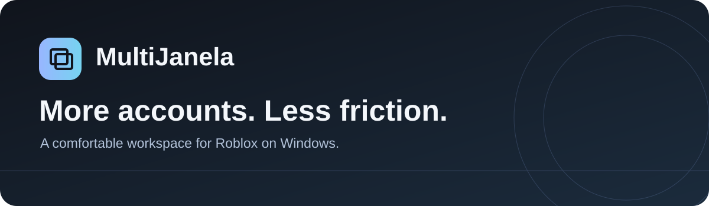
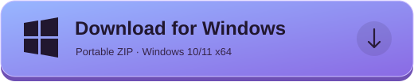
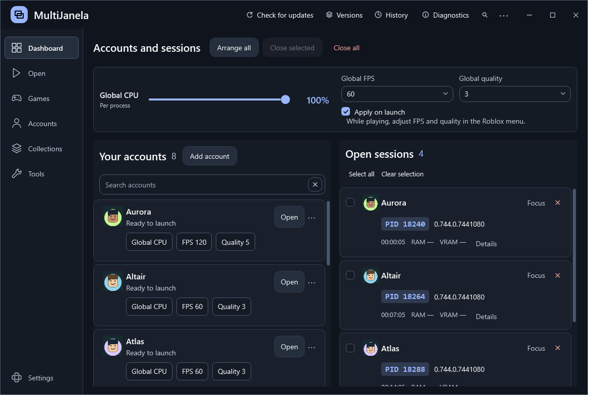

Windows 10/11 x64 · Portable · Free &amp; open source <a href="https://gbzyuuu.github.io/MultiJanela/">Website</a> · <a href="PUBLIC_README.md">English / Português</a> · <a href="CHANGELOG.md">Release notes</a>

# Your Roblox accounts. One comfortable workspace.

MultiJanela brings accounts, running sessions and useful controls together in a native Windows app. Clear information, responsive controls and room to focus.

## Made for your everyday setup

| Manage | Explore | Make it yours |
| --- | --- | --- |
| Separate account and session lists | Search games, save favorites and find servers | Nine themes, text scaling and instant EN/PT switching |
| Global and per-account CPU controls | Join friends and manage friendships | Preferences apply and save automatically |
| Ordered launch queues and saved destinations | Expandable avatar editor with a rotatable 3D preview | Account groups, launch presets and notes |
| Arrange, focus and close windows | Browse communities and permitted member actions | Per-client audio and background muting |

Also included: Roblox version selection, reconnect after a crash, RAM/VRAM monitoring, schedules, compatible TinyTask recordings, protected backups, optional local API/Nexus integrations and scoped JavaScript tools.

## Get started

1. Download the ZIP above and extract it to a folder.
2. Open **RobloxMultiManager.exe**. Microsoft Edge WebView2 Runtime is required; .NET is included.
3. Choose **Add account** and sign in on the official Roblox page.
4. Open an account, or build a launch sequence and choose a game or private link.

The **X** button keeps the manager in the notification area. Choose **Exit MultiJanela** to quit. Updates can transfer control to the newer manager while games remain open.

### Know what changes

CPU and volume controls affect supported running processes. FPS and graphics preferences apply on the next launch, not live. RAM and VRAM are monitors. Avatar previews do not change the account until you apply them. Roblox may limit requests, restrict access or require verification.

This is an unofficial project, not affiliated with Roblox. Multi-instance handling and version pinning alter normal client behavior; there is no guarantee against moderation. The release executable is unsigned. See [compatibility notes](docs/TECHNICAL.md) and [privacy](SECURITY.md).

## Build or contribute

Built with C#/.NET 8, WPF and WebView2. See [build and validation instructions](docs/BUILDING.md). Report reproducible bugs through [Issues](https://github.com/gbZyuuu/MultiJanela/issues); never attach cookies, tokens or your account-data folder.

Licensed under [MIT](LICENSE).

## Português

Gerencie contas e sessões do Roblox em uma interface nativa para Windows. Organize janelas, crie sequências, encontre jogos e servidores, ajuste o uso de CPU e personalize o aplicativo. Temas e preferências locais são aplicados automaticamente.

Baixe o ZIP, extraia e execute **RobloxMultiManager.exe**. Adicione suas contas pela página oficial de login. Consulte o [guia em português](PUBLIC_README.md#português) para os controles e limites de cada recurso.
